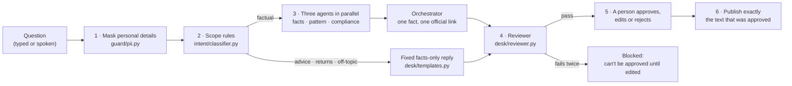

# Safety design — Groww Support Desk

Facts-only, no personal data, nothing written or sent without a person. Every layer below is **code, not a prompt**, and each one names the test (in `api/tests/`) or eval (in `api/app/evals/`) that proves it. All paths are under `api/app/` unless stated.

## The layers a question passes through

The weekly loop goes through the same guards: reviews are masked when they are read, the pulse and explainer are checked against the same scope rules and caps, and each Google write is a separate action a person approves.

## What is enforced, where, and what proves it

| Rule (from the brief) | Enforced in code | Proved by |
|---|---|---|
| **No personal data stored or sent to an AI model.** PAN, Aadhaar, phone, email, UPI id, card, bank account, IFSC and OTP are replaced by `[PAN]`, `[PHONE]`… before anything is saved or sent to Groq/Gemini | `guard/pii.py`, applied to every question at preview and ask (`tickets/service.py`), every Play Store review on ingest (`weekly/reviews.py`), every edited reply and every reply the reviewer rewrites (`approvals/service.py`, `desk/reviewer.py`) | `test_pii.py`; grounding eval: synthetic PAN / account / phone numbers redacted in both loops (55/55, run 7) |
| **No personal data in logs or stored errors.** Every log line, its arguments and tracebacks are masked again; error text saved on actions/runs and the audit log are masked | `guard/logfilter.py` (installed at startup), `approvals/service.py`, `weekly/run.py` | `test_logfilter.py`; grounding eval: nothing sensitive in logs, database or outbox; `test_timing.py` (step timings carry no question text) |
| **Voice audio is never kept.** The clip stays in memory, is sent to Whisper and dropped; only the masked transcript comes back. Clips under 1 s, over 61 s or over 5 MB are refused | `api/public.py` (`/api/voice/transcribe`), `voice/stt.py` | `test_voice.py` (`test_audio_never_written_to_disk`, `test_transcribe_returns_redacted_preview`, clip-length tests) |
| **No advice, no buy/sell language, no return or performance figures.** Advice and returns questions get a fixed refusal; off-topic questions (banking, loans, stocks, crypto…) get a fixed "what we answer" reply | `intent/classifier.py` (rules first, AI only for unclear wording), `desk/compliance.py`, `desk/templates.py`, `guard/scope.py` | `test_intent.py`, `test_off_topic.py`, `test_scope.py`; grounding eval: advice and return requests refused |
| **Every factual reply carries exactly one official link and its "last checked" date** — or says "not covered" and names what it searched | `desk/reviewer.py` (one link, it must be the fact's source, last-checked date present), `desk/templates.py` (`not_covered_reply`) | `test_reviewer.py`; feasibility eval (44/45) |
| **Official public sources only.** Pages are fetched and cited only from `groww.in`, `amfiindia.com`, `sebi.gov.in` | `config.py` `is_allowed_source_url`, used by the page fetcher, the reference pages and the explainer check | feasibility and grounding evals (every citation is on an allowed host; 15 sampled claims found on the cited page) |
| **Length caps:** reply ≤ 3 sentences, pulse ≤ 250 words, explainer ≤ 6 bullets | `guard/scope.py` `CAPS` + `check_output`; reviewer truncates replies; `weekly/pulse.py`, `weekly/explainer.py` | `test_scope.py`; feasibility eval (weekly run: pulse ≤ 250 words, explainer ≤ 6 bullets) |
| **A draft that fails review can't be published.** The reviewer rewrites once; still failing → *blocked*, and Approve stays off until a person edits it. An edit goes back through the reviewer | `desk/reviewer.py`, `approvals/service.py` (`approve` refuses blocked drafts; `edit_draft` re-reviews) | `test_reviewer.py`, `test_approvals.py`, `test_desk_api.py`; browser test "a draft the reviewer blocks cannot be approved" |
| **Nothing is written or sent without a person approving that specific action.** Each reply and each Google write is its own pending action; approval is claimed atomically (two clicks can't both win) and recorded in the audit log. `AUTO_APPROVE` is off by default and off on the live site | `approvals/service.py` (`_claim`, `audit`), `config.py` (`auto_approve = False`) | `test_approvals.py`, `test_auto_decide.py`; edit-isolation eval (5/5: one approve/edit/reject changes exactly the expected rows) |
| **What is published is exactly what the person saw.** Approve sends the reply text the card showed; if it changed since, the server refuses (409). Hindi reaches the asker only if the approver was shown exactly that Hindi | `api/desk.py` (approve), `approvals/service.py` (`seen_translation`, checked after the claim), `api/public.py` | `test_desk_api.py`, `test_translation_async.py` |
| **Google: append and draft only, never send.** The only writes are an append to the pulse Doc and a Gmail *draft*; the send tool is blocked in code | `delivery/mcp_client.py` (`DENYLIST = {"gmail_send_email"}`), `approvals/executors.py` | `test_executors_link2.py` (`test_send_tool_is_denylisted`, `test_email_approve_creates_gmail_draft_never_sends`) |
| **A Hindi translation can't change the facts.** It must keep every link and every number, contain no personal data and be in Hindi script, or it is thrown away (English only) | `desk/translate.py` `validate_translation` | `test_translate.py` |
| **The open page can't be abused.** Per-visitor limits: 10 questions / 10 min (300 a day), 30 previews / 10 min, 3 voice clips / min, 30 approval clicks / 10 min, one weekly run an hour | `guard/ratelimit.py` | `test_ratelimit.py`, `test_desk_api.py` |

## Known limits (honest)

- Personal-data masking is pattern-based (the nine kinds above). A detail written in an unusual form may not be caught.
- The page has no password (a decision on 2026-11-19): anyone on it can approve. That is why Google writes are limited to a Doc append and a Gmail draft, and why approve is rate-limited.
- The admin console (`/api/console/*`, needs `X-Console-Key`) approves replies without the "Hindi you saw" check; the page does not use it.
- Rate limits are kept in memory, so they reset when the API restarts.
